# Making Pika Jump: a vibe-coding example

> **▶ Play the game: https://matthewjack.github.io/pika-jump/**
>
> **Source code on GitHub: https://github.com/matthewjack/pika-jump**

This is a step-by-step record of how **Pika Jump** was built by talking to an AI coding agent. Pika Jump is a Mario-style platformer with Pokémon battles, catching and evolution. The record is for anyone curious about "vibe coding" a game but unsure what it looks like in practice.

- **Who:** an uncle and a 10-year-old. The uncle handled setup and housekeeping (prompts 1, 2, 4, 6 and 7). **The child dictated every game feature (prompts 3, 5 and 8)** and also edited the level by hand.
- **Tool:** [Claude Code](https://claude.com/claude-code), running Claude Opus 5.5 in a terminal on a Mac.
- **Stack:** [Phaser 4](https://phaser.io) (a 2D game framework), TypeScript and Vite.
- **Time:** about 1 hour 40 minutes from an empty folder to the evolution commit.
- **Result:** about 2,100 lines of TypeScript. No code was written by a human, apart from the child's edit to the level map.

Each prompt below is quoted **exactly as given**, including speech-to-text slips ("rat-a-tat" is Rattata). They're left in on purpose: this is what real prompts from a child look like, and the AI coped with them fine.

---

## Prompt 1: choosing a framework (uncle)

> Hi! I'm interested in creating a platform game with core gameplay similar to Mario but using Pokemon characters and cursor keys for movement. First, what are the pros and cons of creating this driven by AI with different game frameworks or engines?

**Result:** no code yet, just advice. The AI compared Phaser, KAPLAY, plain HTML Canvas, Godot, Unity, Pygame and GameMaker. Its main point was that an AI works best when the whole game is plain text files it can write, run and check itself. It recommended **Phaser + TypeScript** in the browser, and warned that Nintendo actively takes down fan games that use Pokémon.

> **Tip:** asking "what are my options?" before "build it" costs one prompt and gets you a stack that suits AI-driven work.

## Prompt 2: build a starter project (uncle)

> Yes Phaser with Typescript. This is for a personal kids project only, not commercial. If we can directly copy from Pokemon IP that would be perfect, but if the model may struggle with that then we can make it just "inspired". Yes create a repo and a simple project.

**Result:** a git repo and a playable level. Pikachu runs and jumps with the arrow keys. There are Poké Balls to collect, "?" blocks to bonk, Rattata enemies to stomp, pits and a goal flag. The AI couldn't reproduce official sprites, so it **drew Pokémon-style pixel art as text in the code**, e.g. `'.yykyyyyyykyy.yy'` is one row of Pikachu. It also documented how to swap in real sprite images later. Its browser extension wasn't connected, so it **played the game itself in headless Chrome**, pressing keys through a script and taking screenshots. That found a bug where enemies walked into pits before you could see them.

| The first playable level | Reaching the flag |
|---|---|
| 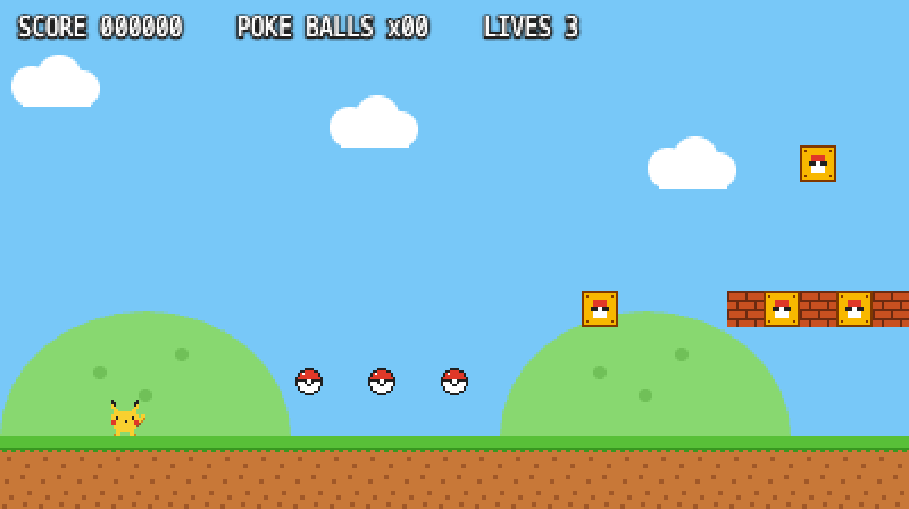 | 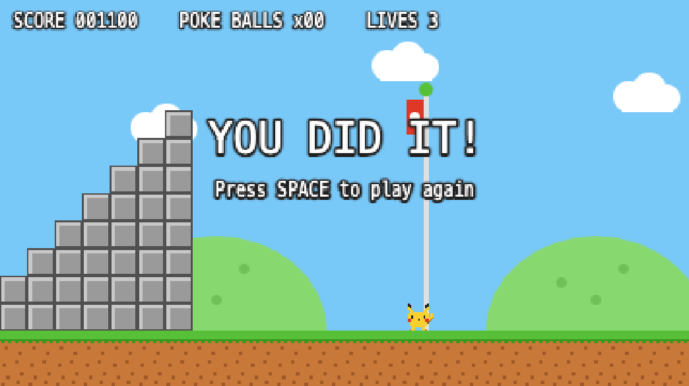 |

## Prompt 3: battles (child)

> when you hit a rat-a-tat, it, you immediately have to battle it, and you can either hit it or run away from it. And if you jump over it, you don't have to battle it. When you hit it, like you have these different moves that you can do. There, you can attack. You you can like say use an attack called Thunderbolt, and it might do like ten heart. Like the red attack has these health points, and when you hit it, the it loses some of its health points. Say like five health points, and. It can also attack you, and you also have health points. It's like playing Pokemon.

**Result:** touching a Rattata now starts a classic turn-based battle screen with HP bars, a FIGHT/RUN menu, and Thunderbolt (10 damage, as requested), Thunder Shock and Quick Attack, each with its own animation. The AI made sensible guesses where the child didn't say: Rattata's HP and attacks, that Poké Balls heal 1 HP, and that losing a battle costs a life. Its self-testing found a real bug: after running away, the same Rattata could start a new battle straight away. It fixed that.

| Choosing a move | Thunderbolt! |
|---|---|
| 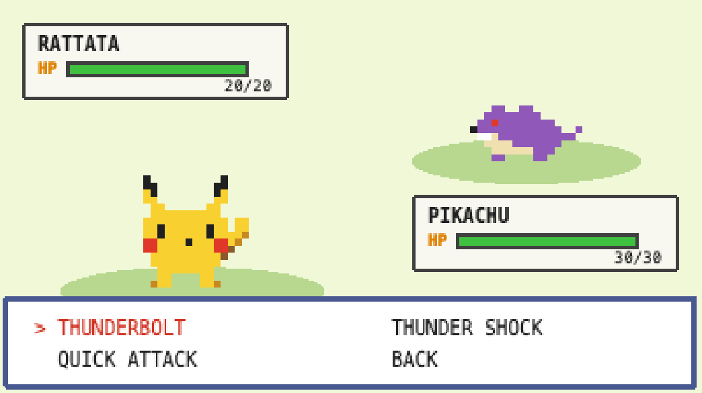 | 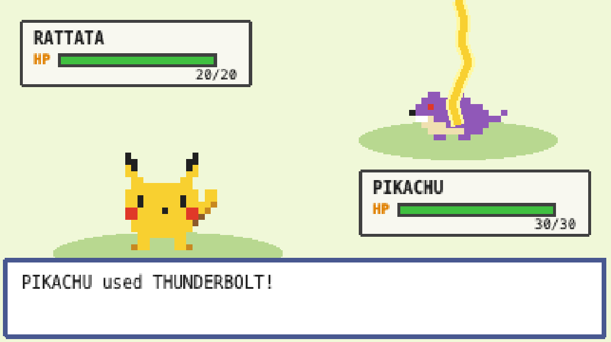 |

## Prompt 4: checking the AI's work (uncle)

> describe the commits

**Result:** a summary of both commits. While writing it, the AI **found its own mistake**: its test scripts had accidentally committed 86 MB of temporary browser files. It removed them, fixed the commit and added a rule so it couldn't happen again.

> **Tip:** asking "what did you change?" every now and then is cheap, and it catches things.

## Prompt 5: forest, wild Pokémon, catching, switching (child)

> Ok, next changes. When the when you're walking around, the background is just trees and grass. And there will be Pokemon walking around. And uh, same battle features and things. If you wanna, if you want one of the Pokemon, you can throw the Pokeballs you've collected, I guess. And uh, when you, and there's a 50% chance that you can catch it, and a 50% chance that you won't. And if you catch it, you basically get to keep it and you can switch between the different Pokemon.

**Result:** this was the biggest change. It added:
- a layered forest background
- six wild Pokémon (Rattata, Pidgey, Caterpie, Bulbasaur, Charmander, Squirtle), each with its own sprite and moves; Pidgey flies
- a **BALL** option with the exact 50/50 catch chance, including a throw, wobble and "Gotcha!" animation
- a team of up to 6 Pokémon you can switch between in battle, or in the level with the **S** key, so you can run and jump as Charmander 

[*Uncle: I think the level-character switch wasn’t the child’s intent, but he seemed happy enough when we discovered it*]

When a Pokémon faints you pick the next one. Testing showed Caterpie was nearly invisible on the grass, so the AI gave every sprite a dark outline.

| The new forest | The new battle menu |
|---|---|
| 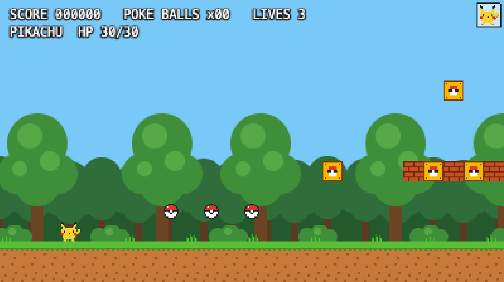 | 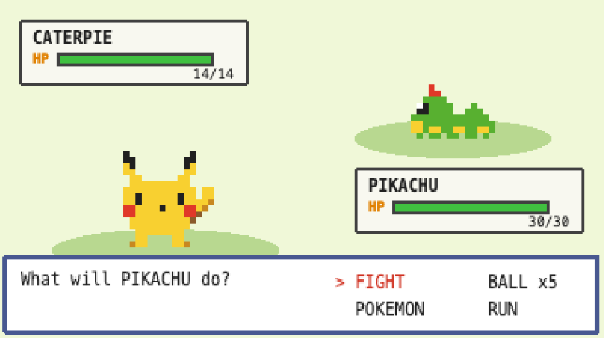 |
| **Gotcha!** | **Playing as the caught Caterpie** |
| 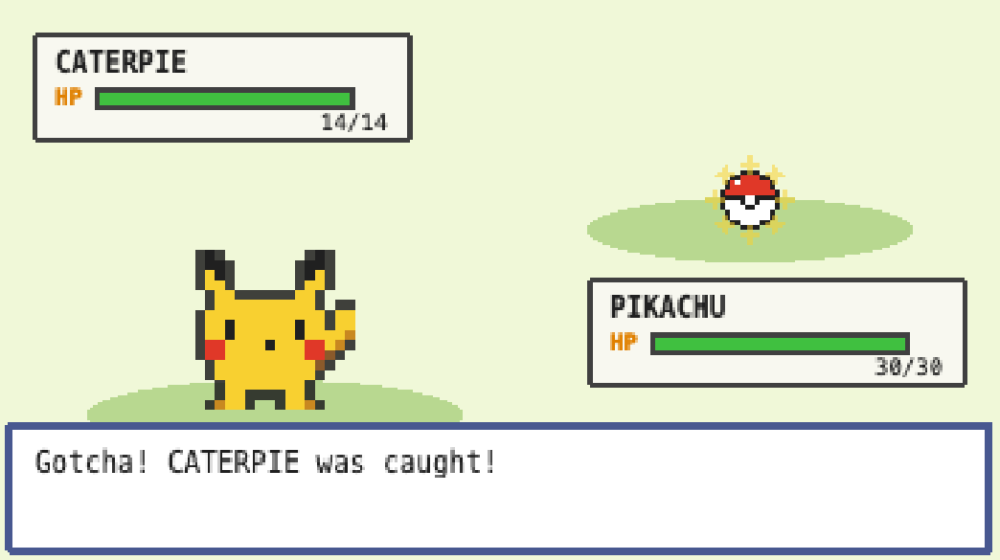 | 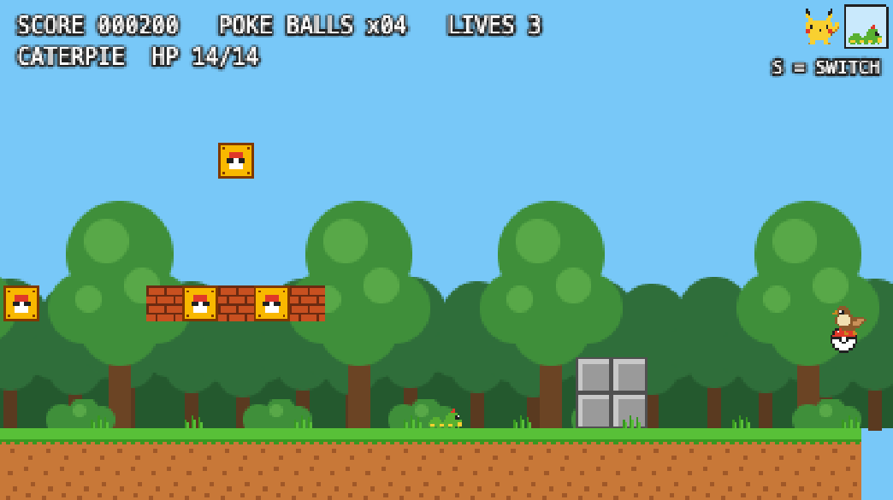 |

## Prompt 6: how to edit levels (uncle)

> What is a good way to open a level for editing?

**Result:** advice, no code. The level is a text grid where `#` is ground, `o` is a Poké Ball, `h` is Charmander and so on. The AI saw that Cursor was installed and gave the command to open the level in it. It also explained that the game reloads every time you save, warned against TextEdit (its curly quotes break the code), and offered to build an in-game level editor.

## Prompt 7: opening the editor (uncle)

> `open -a Cursor src/levels/level1.ts` *(run directly in the session)*

**Result:** with the file open, **the child edited the level by hand**, adding a Rattata, a Squirtle and a random Pokémon near the start. The AI later noticed the edit, checked it hadn't misaligned anything, and kept it as the child's own change.

| Before the child's edit | After: a Rattata and a Squirtle waiting near the start |
|---|---|
| 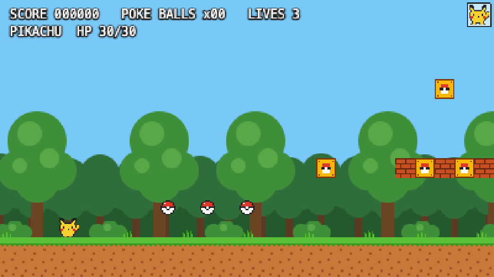 | 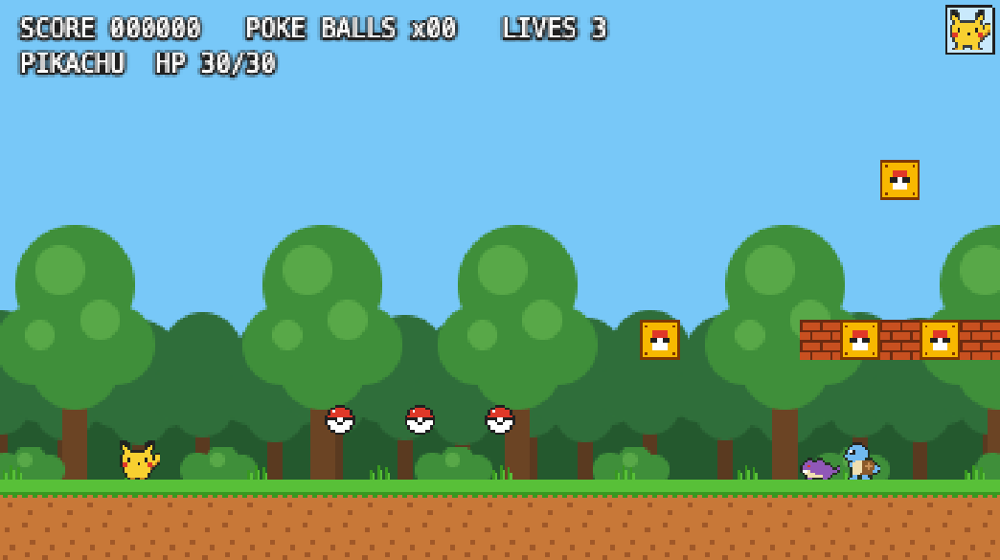 |

## Prompt 8: evolution (child)

> Uh, and as an additional change, we should definitely add the evolution if it reaches a certain, if the Pokemon reaches a certain level, and it'll, t and it'll evolve into a, like, a more advanced Pokemon.

**Result:** levels and XP (winning or catching gives XP; 25 XP per level), and eight evolutions with new sprites and stronger moves:
- Pikachu → Raichu
- Caterpie → Metapod → Butterfree
- Rattata → Raticate, Pidgey → Pidgeotto, Bulbasaur → Ivysaur, Charmander → Charmeleon, Squirtle → Wartortle

Evolution plays the classic "What? PIKACHU is evolving!" flicker. The AI deliberately set evolution levels much lower than in the real games so a child sees evolutions within a few battles, and said so. Testing also showed another wild Pokémon could walk into you and start a battle the moment one ended, so it added a short safe period.

| "What? PIKACHU is evolving!" |
|---|
| 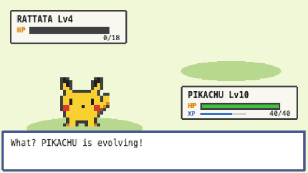 |

---

## Lessons for first-timers

- **Say what you want in your own words.** A 10-year-old's rambling, dictated descriptions were enough. The AI turned "it might do like ten heart" into "Thunderbolt does 10 damage" and "rat-a-tat" into Rattata.
- **The AI fills gaps, so read its summary.** It made dozens of small design decisions nobody asked for: healing from Poké Balls, low evolution levels, removing the Mario stomp. Each was explained, and any of them can be undone with one more sentence.
- **Ask it to test its own work.** It played the game in a hidden browser after every change and found real bugs before a human saw them: a battle that restarted after running away, an invisible Caterpie, back-to-back battles. It can't tell you whether the game is *fun*, though. That's what the kids are for.
- **It makes mistakes too.** The 86 MB of junk files only surfaced because someone asked "describe the commits". Check in now and then.
- **Ask for things kids can change.** The level is a text grid and every Pokémon's HP and move damage sit in one file, so a child edited the game directly without going through the AI.
- **Mind the copyright.** Pokémon belongs to Nintendo. A private family game is fine, but a public one with real Pokémon names and characters may get taken down.

---

## A final thought: to what extent was our rapid success based on copying well-known titles?

Looking back, the session seemed to move fastest when the prompts were big, high-level directions borrowed from famous games ("it's like playing Pokémon", "you can throw the Poké Balls", "add evolution") rather than detailed specifications or new ideas. The evidence supports that, but it doesn't prove as much as it seems to.

**What supports it.** Prompts 5 and 8 were each a few rambling sentences, and each produced a large, coherent feature: catching with a wobbling ball, a switchable team, levels, XP, and evolution with its familiar flicker. None of those details were spelled out. They didn't need to be, because "like Pokémon" refers to decades of conventions the AI already knows in detail. A familiar reference works like a compressed specification: a few words stand in for pages of design.

**Why that's not the whole story.**

- **The child did give details, and they were followed exactly**: Thunderbolt does 10, there's a 50% catch chance, and you jump over to avoid a battle. Details weren't slow. They cost a sentence each. What made the prompts powerful was *shared vocabulary*, not vagueness. Precise details plus a well-known reference was the strongest mix.
- **"Fast progress" was measured against a target everyone already knew.** It's easy to feel productive when the output matches a picture in your head that the AI shares. An original mechanic has no shared picture, so it takes some back-and-forth to converge. That's a different kind of work, not necessarily slower, and this session never tried it, so there's no comparison.
- **The gaps were filled with the source game's defaults.** Wherever the prompts were silent, the AI chose Pokémon conventions or its own guesses, such as healing from Poké Balls and low evolution levels. That makes the game feel finished quickly, but steers it toward a copy. Speed and originality pull against each other here.
- **The speed is partly a property of the AI.** Models know the most about the most famous games, so borrowing from them plays to the AI's strengths. Original ideas are where the human, child or adult, is the only source, which is an argument that original ideas are where human prompting matters most.
- **Copying has costs that don't show up as speed.** The result can't safely be shared widely without renaming everything, and nobody has measured whether it's *fun*.
- **The project was itself a mild original idea.** "Mario, but with Pokémon battles, and you can play as what you catch" isn't a game that exists. Combining two well-known references worked well, which suggests a middle path between pure copying and building from scratch.

**A practical takeaway:** use famous games as shorthand for the parts you're happy to borrow, state the exact numbers and rules you care about, and save your prompts for the one or two ideas that make your game *yours*. Those are the parts the AI can't fill in for you.
